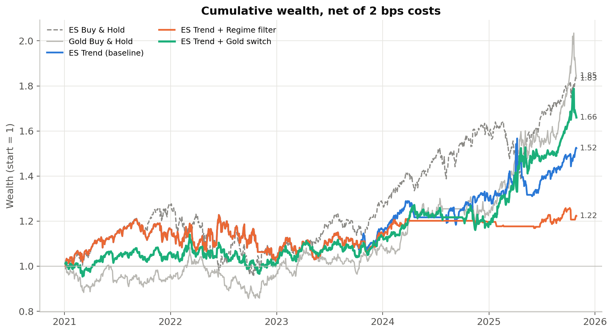
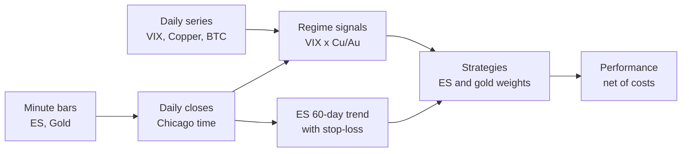
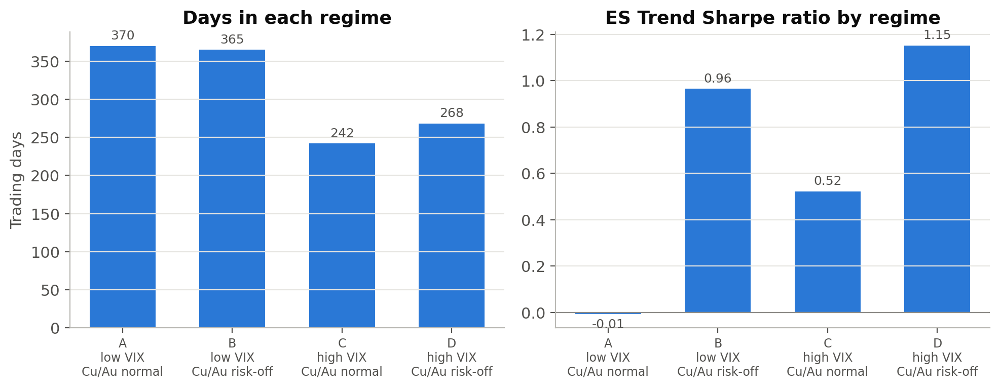
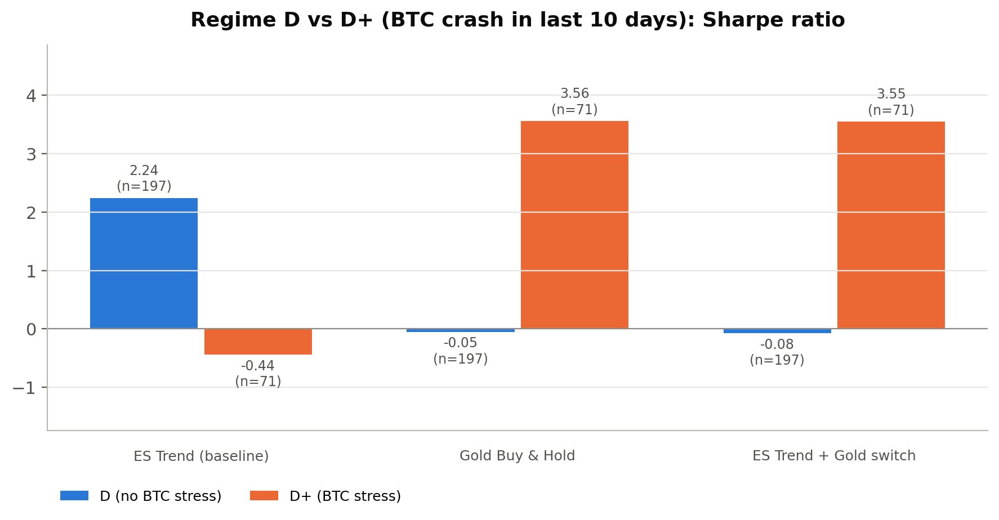

# Regime-Aware Futures: ES Trend and Gold

VIX x Copper/Gold risk regimes for an ES trend strategy and gold allocation (Python).

Research from an internship at a Taiwan futures brokerage (2026). The code and
results are public; the underlying market data are proprietary and are not
included (see [data/README.md](data/README.md)).

## Key Results

Evaluation period 2021-01-01 to 2025-10-29 (1,245 trading days). All figures
are net of 2 bps per unit of turnover. Sharpe ratio uses a risk-free rate of 0.

| Strategy | CAGR | Volatility | Sharpe | Max drawdown |
|---|---:|---:|---:|---:|
| ES Buy & Hold | 13.20% | 16.95% | 0.816 | -24.90% |
| Gold Buy & Hold | 13.05% | 15.39% | 0.875 | -20.84% |
| 50/50 ES + Gold Buy & Hold | 13.80% | 11.96% | 1.141 | -18.07% |
| **ES Trend (baseline)** | 8.90% | 16.15% | 0.609 | -16.57% |
| ES Trend + Regime filter | 4.16% | 13.57% | 0.368 | -16.57% |
| **ES Trend + Gold 50/50 (no switch)** | 11.59% | 11.66% | 0.998 | -15.25% |
| ES Trend + Gold switch | 10.80% | 13.04% | 0.852 | -15.25% |
| Alt: VIX-filtered ES + Gold 50/50 | 5.73% | 8.33% | 0.710 | -11.25% |

Full table (gross Sharpe, turnover, time in ES):
[results/table_performance.csv](results/table_performance.csv)

What the numbers say:

- **Smaller losses.** The ES trend strategy's worst drawdown is -16.6%, versus
  -24.9% for buying and holding ES. In 2022, when ES fell 18.8%, the trend
  strategy lost 10.6%.
- **Trend and gold work well together.** Their daily returns are almost
  uncorrelated (0.09). Holding half trend and half gold raises the Sharpe
  ratio from 0.61 to 1.00 and lowers volatility from 16% to 12%.
- **The trend strategy earns the most in the worst regime.** In regime D
  (high VIX and weak copper/gold), the trend strategy has its best Sharpe
  ratio (1.15) of all four regimes. This is why switching it off in D
  (Regime filter) or replacing it with gold in D (Gold switch) does worse
  than leaving it alone.
- **Results are stable.** Delaying every signal by one more day leaves the
  conclusions unchanged, and trading costs reduce the Sharpe ratio by only
  about 0.02-0.04.
- **Simple buy and hold was hard to beat in this sample.** Stocks and gold
  both rose strongly in 2021-2025, and a 50/50 buy-and-hold mix has the
  highest Sharpe ratio (1.14). The value of the trend strategy here is
  controlling losses and understanding risk states, not higher returns.



## The Idea

**Check the weather before choosing what to wear.** Markets have "weather"
too. Two simple gauges describe it:

- **VIX** is the market's fear gauge. High VIX means a stormy sea.
- **The copper/gold price ratio** is a growth-versus-safety gauge. Copper is
  bought to build things, so it rises when the economy looks strong. Gold is
  bought for safety, so it rises when people are worried. A low ratio means
  investors are hiding in the safe.

Combining the two gauges gives four regimes:

| | Copper/gold normal | Copper/gold weak (risk-off) |
|---|---|---|
| **Low VIX** | A: calm | B: growth worry |
| **High VIX** | C: market fear | D: both (worst case) |

**A trend strategy is like surfing.** It follows the direction of the
market: long when ES is higher than 60 trading days ago, short when it is
lower. A surfer earns the most on big waves, and a trend strategy earns the
most when markets move strongly, which often happens in stormy regimes.
The question this project asks is: should the surfer leave the water when
the weather turns bad, move to gold, or keep surfing?

## How It Works



### Signals

- **VIX high:** today's VIX is at or above its median over the past year
  (rolling 252 trading days).
- **Copper/gold risk-off:** today's copper/gold ratio is more than 0.5
  standard deviations below its average of the previous 3 years (z-score
  below -0.5).
- **ES trend:** +1 (long) if ES is higher than 60 trading days ago, -1
  (short) if lower.
- **BTC stress (analysis only):** at least one Bitcoin daily drop of 5% or
  more in the last 10 calendar days.

### Strategies

| Strategy | Rule |
|---|---|
| ES Trend (baseline) | 60-day trend on ES; flat on the first trading day of each quarter (contract roll); -5% stop-loss per trade |
| ES Trend + Regime filter | Baseline, but flat when the previous day was regime D |
| ES Trend + Gold 50/50 (no switch) | 50% baseline + 50% long gold, every day |
| ES Trend + Gold switch | Outside D: 50% baseline + 50% gold. In D: 100% gold |
| Alt: VIX-filtered ES + Gold 50/50 | 50% baseline, flat when VIX is high; 50% gold, flat in D |
| Benchmarks | ES buy and hold, gold buy and hold, 50/50 ES + gold (rebalanced daily) |

### No look-ahead

The backtest only uses information that was actually available at the time
of each trade:

- **Signals act one day later.** A signal known at today's close sets
  today's position, which earns tomorrow's return.
- **BTC waits one extra day.** Bitcoin's daily close (00:00 UTC) comes after
  the ES close (16:00 Chicago time), so the latest finished BTC day is always
  one day behind.
- **Thresholds use only the past.** The VIX median and the copper/gold
  z-score are computed on rolling windows of past data, never on the full
  sample.
- **Stop-loss losses count.** When a trade hits -5% at the close, that day's
  loss is kept. The strategy then stays flat until the trend changes
  direction.
- **One clock.** All futures data are converted to Chicago time before daily
  closes are built (details in [data/README.md](data/README.md)).

### Robustness: every signal one more day late

| Strategy | Sharpe (base) | Sharpe (+1 day) | Max drawdown (base) | Max drawdown (+1 day) |
|---|---:|---:|---:|---:|
| ES Trend (baseline) | 0.609 | 0.596 | -16.57% | -19.68% |
| ES Trend + Regime filter | 0.368 | 0.514 | -16.57% | -19.68% |
| ES Trend + Gold 50/50 (no switch) | 0.998 | 0.995 | -15.25% | -15.75% |
| ES Trend + Gold switch | 0.852 | 0.905 | -15.25% | -15.75% |

## Regime Findings

### The trend strategy in each regime

The regime is the state known at the previous close.

| Regime | Days | Share | ES Trend annual return | ES Trend Sharpe |
|---|---:|---:|---:|---:|
| A: low VIX, Cu/Au normal | 370 | 29.7% | -0.11% | -0.009 |
| B: low VIX, Cu/Au risk-off | 365 | 29.3% | 9.66% | 0.964 |
| C: high VIX, Cu/Au normal | 242 | 19.4% | 12.13% | 0.522 |
| D: high VIX, Cu/Au risk-off | 268 | 21.5% | 21.73% | 1.152 |

The trend strategy makes almost nothing in calm markets (A) and the most in
the worst regime (D). Regime D only appears from 2023 onward, which is why
the Regime filter and the baseline have identical returns in 2021 and 2022.



### Inside regime D: does a recent Bitcoin crash matter?

Regime D days were split by whether Bitcoin had a crash day (-5% or worse)
in the previous 10 calendar days (D+).

| Strategy | Group | Days | Annual return | Sharpe |
|---|---|---:|---:|---:|
| ES Trend (baseline) | D, no BTC stress | 197 | 33.82% | 2.243 |
| ES Trend (baseline) | D+, BTC stress | 71 | -11.83% | -0.443 |
| Gold Buy & Hold | D, no BTC stress | 197 | -0.90% | -0.051 |
| Gold Buy & Hold | D+, BTC stress | 71 | 71.63% | 3.561 |

Within the same regime, the two groups behave very differently: without
BTC stress the trend strategy does very well, while with BTC stress it loses
money and gold does very well. This is a **descriptive finding only**. D+
has just 71 days, and the pattern was noticed after looking at the results,
so it is not used as a trading rule and no performance is reported for one.



## Repository Contents

| Path | Description |
|---|---|
| `src/data_checks.py` | Data audit: table inventory, time-zone detection from the daily trading halt, gaps, partial days, largest daily moves, coverage, alignment check. Explains where each cleaning rule comes from. Read-only. |
| `src/regime_backtest.py` | Main script: cleaning, regime signals, strategies, metrics, tables and figures. |
| `results/` | Output tables (CSV) and figures (PNG) from the run reported above. |
| `data/README.md` | Data tables, formats, time zones, gaps and cleaning rules. The data themselves are not included. |
| `requirements.txt` | Python packages. |

Figures in `results/`:

| File | Content |
|---|---|
| `fig1_cumulative_wealth.png` | Cumulative wealth of the main strategies and benchmarks |
| `fig2_vix_regime.png` | VIX and its rolling 1-year median |
| `fig3_cuau_regime.png` | Copper/gold z-score and the risk-off threshold |
| `fig4_regimes.png` | Days in each regime and the trend strategy's Sharpe ratio by regime |
| `fig5_weights.png` | Actual ES and gold weights of the Gold switch portfolio |
| `fig6_D_vs_Dplus.png` | Regime D vs D+ Sharpe ratios |

## Data

Minute bars for E-mini S&P 500 futures (ES) and gold futures (GC), plus
daily VIX, copper futures (HG) and Bitcoin, from 2020 to October 2025.
Formats, time-zone handling, data gaps and every cleaning rule are documented
in [data/README.md](data/README.md).

## How to Run

The scripts need the proprietary database, so they cannot be run without it.
With the database placed at `data/futures.db`:

```bash
pip install -r requirements.txt
python src/data_checks.py       # data audit (prints only)
python src/regime_backtest.py   # backtest; writes tables and figures to results/
```

Run both commands from the repository root. The backtest takes about 1-2
minutes. In Google Colab, copy the repository and the database into the
Colab session, change into the repository folder, and run the same commands
with a leading `!`.

## Limitations

- **Short sample.** About 5 years of data (4.8 years evaluated). Regime D
  only appears from 2023, and D+ has only 71 days.
- **A strong market for buy and hold.** Stocks and gold both rose strongly
  in 2021-2025; a 50/50 buy-and-hold mix beat every active strategy on
  Sharpe ratio.
- **Regime switching did not help.** Going flat in D, or moving fully to
  gold in D, both did worse than not switching, because D is when the trend
  strategy earns the most.
- **No out-of-sample test.** The parameters (60-day trend, -5% stop-loss,
  -0.5 z-score threshold, 1-year VIX median, 3-year copper/gold window) come
  from the original research design and were not validated on separate data.
- **Gold data gap.** GC has no data from 2024-07-29 to 2024-09-30. The gold
  return is treated as 0 in that period and the copper/gold signal keeps its
  last value (a flat line in fig3).
- **Simplified costs.** A flat 2 bps per unit of turnover (actual ES/GC
  costs are roughly 0.5-1 bp). Margin, slippage and contract-roll details are
  not modeled.

## License

MIT, see [LICENSE](LICENSE).
